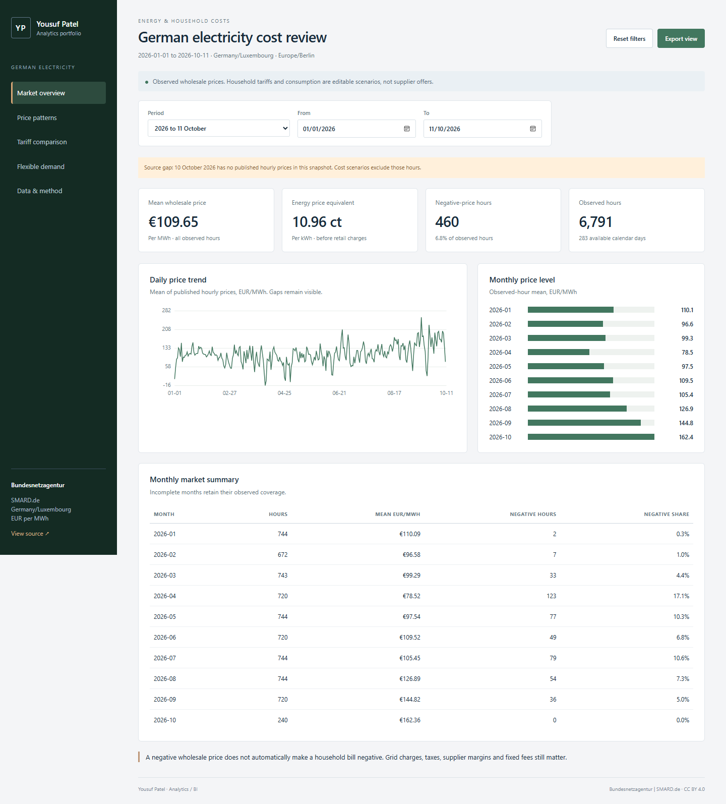

# Yousuf Patel — analytics portfolio

**[Open the live portfolio and both interactive dashboards](https://yousufpatel41-collab.github.io)**

## Cloud Cost and Budget Dashboard

[Open the live dashboard](https://yousufpatel41-collab.github.io/cloud/) | [View the project files](cloud-cost-dashboard) | [Download the complete package](downloads/Cloud_Cost_Dashboard_Project.zip)

Cloud cost analysis using Python, SQL, Excel and an interactive browser dashboard, with a native Power BI project. The analysis covers 135,272 Microsoft sample billing records, 13 accounts and 36 services.

The project includes editable budget assumptions, allocation analysis, financial checks, screenshots, a business report and reproducible data preparation. Power BI Desktop refresh remains unverified.

See the project README for setup, sources, findings and interview notes. The complete package includes the large prepared billing CSV and SQLite database; these can also be recreated with the included scripts.

## German Electricity Cost Dashboard

[Open the live dashboard](https://yousufpatel41-collab.github.io/electricity/) | [View the project files](german-electricity-dashboard) | [Download the complete package](downloads/German_Electricity_Dashboard_Project.zip)

Analysis of 24,335 real published SMARD hourly electricity prices, with an interactive dashboard, editable Excel tariff scenarios, SQL database, raw source snapshot, business report and Power BI project. The model preserves negative prices, daylight saving time and missing data. Household tariffs are illustrative; Power BI Desktop refresh remains pending.

The research upgrade adds a constrained EV charging planner, private browser-local consumption CSV analysis, English/German advanced pages and a chronological seasonal-naive / LightGBM / Chronos-Bolt tiny comparison. On 40 simulated 2026 test sessions, the selected Chronos model captured 43.5% of the same-constraint perfect-foresight saving opportunity. These are sampled model-based results, not annual or realised household savings. [Forecast evidence](https://yousufpatel41-collab.github.io/electricity/?view=forecast) · [Frozen protocol](german-electricity-dashboard/EXPERIMENT_PROTOCOL.md).

