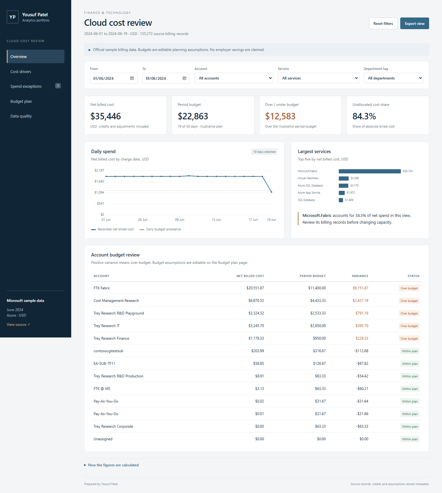

# Cloud Cost and Budget Dashboard

An Analytics / BI portfolio project by Yousuf Patel. **[Open the live dashboard](https://yousuf-patel-analytics.boldsloth2.chatgpt.site/cloud/).** It answers three questions: where cloud spending is concentrated, how account spend compares with a planning scenario, and how much cost can be allocated to a department.

**Data:** Microsoft's official FOCUS sample, 1-19 June 2024, USD. **Budgets:** illustrative assumptions. This is a portfolio analysis, not client work or a claim of realised savings.

[Download the complete project package](https://github.com/yousufpatel41-collab/yousuf-patel/raw/refs/heads/main/downloads/Cloud_Cost_Dashboard_Project.zip). It includes the large billing CSV and SQLite database, which are omitted from the individual Git file tree. You can also recreate them using the scripts below.



## Open the project

- **Dashboard:** open `dashboard/index.html` in a browser. It works without a server or an internet connection. For a local server, run `python -m http.server 8741` from this folder and visit `http://localhost:8741/dashboard/`.
- **Excel:** open `Cloud_Cost_Review.xlsx`. Change the dates on Review within 1-19 June 2024 or edit the blue budget cells on Budgets. Formulas and charts recalculate. Daily costs contains the 4,492 prepared daily rows; the prepared billing records are in the separate CSV.
- **Power BI:** open `powerbi/CloudCosts.pbip`, set the DataFolder parameter and refresh. See `powerbi/README.md` for setup and verification limits.
- **Business report:** `reports/Cloud_Cost_Business_Review.pdf` contains the findings, next steps and method.
- **SQL:** `data/cloud_costs.sqlite` is ready to query. `sql/model.sql` defines the views and `sql/analysis.sql` contains five business queries.

The dashboard has five views: Overview, Cost drivers, Spend exceptions, Budget plan and Data quality. Date, account, service and department filters update the analysis. Exports download the displayed table. Budget edits persist in that browser; Restore assumptions resets them. They do not update the source CSV, Excel or Power BI. No account budget is shown after a service/department filter because no budget exists at that grain.

## Findings

| Measure | Result |
|---|---:|
| Source billing records | 135,272 |
| Accounts / services | 13 / 36 |
| Net billed cost | $35,445.86 |
| Effective cost | $36,040.60 |
| Fabric share of net billed cost | 58.5% |
| Unallocated share of absolute billed cost | 84.3% |
| Period scenario budget | $22,863.33 |
| Scenario variance | $12,582.53 / 55.0% |
| Spend review candidates | 0 |

Fabric should be reviewed with its platform owner, using capacity utilisation before any resizing decision. Missing department allocation is a governance follow-up. Neither figure establishes waste. Replace the budget assumptions with approved amounts before using variance for management decisions.

## Data and calculation choices

Credits and adjustments stay in the data. Net billed cost equals positive charges plus negative charges; effective cost is a separate measure. No amounts are rounded before aggregation. Floating-point reconciliation uses a $0.000001 tolerance.

Tags are parsed as JSON with case-normalised keys. Empty department tags become Unallocated. Allocation coverage uses absolute billed cost to avoid cancellation between credits and charges. Missing account IDs receive an explicit Unknown value. Display names are not keys: two separate accounts are both called Pay-As-You-Go.

Monthly budgets are authored at account ID and billing month. Costs are aggregated before joining the budget, preventing duplicated budget amounts. The daily allowance is the monthly budget multiplied by selected calendar days divided by 30. This simple phasing is an assumption; source coverage is a partial month and no forecast is shown.

Spend review uses the preceding seven calendar days, excluding the day being scored. A candidate needs a baseline of at least $25, a ratio above 1.8 and excess above $100. The first seven days are not scored. A date absent from the billing extract is filled with zero recorded cost for this rule, not asserted to have zero usage. The current sample produces no candidates.

## Rebuild and check

Python 3.11+ is sufficient. Install dependencies in a virtual environment:

```text
python -m pip install -r requirements.txt
python src/download_sample.py --directory .cache/source
python src/build_data.py --source .cache/source/EA-Cost-FOCUS_1.0.csv
python src/build_powerbi.py
python src/build_report.py
python -m unittest discover -s tests -v
```

The download is pinned to Microsoft release v14 and checks the archive and source SHA-256. It extracts only the needed source file. The included billing CSV keeps the columns used by this analysis plus derived fields; the complete original source can be downloaded with the script. Rebuilding resets the illustrative budget CSV and dashboard data to the baseline scenario.

The included Excel workbook was authored separately and is ready to edit. The Python rebuild commands regenerate data, dashboard payloads, SQL database, native Power BI project and the business report; they do not regenerate the workbook. `tests/test_financial_model.py` checks the included workbook against rebuilt data, so a changed source requires rebuilding Excel too.

Checks cover net cost including adjustments, row/count reconciliation, budget join grain, duplicate account display names, allocation denominator, SQL execution, BI dimension keys and Excel formulas/charts. `reports/data_checks.json`, `dashboard_checks.json` and `powerbi_checks.json` record the results. Dashboard controls were exercised in Edge; the Power BI files passed schema validation but were not opened or refreshed in Desktop.

## Interview notes

**Why this project?** Cloud cost reviews need billing reconciliation and an accountable allocation/budget model before attractive charts are useful.

**What would I change with production data?** Use approved budgets and their phasing, map shared costs with an agreed allocation rule, compare billing against capacity/utilisation data, and schedule ingestion with alerts for late or missing records. Add more months before forecasting or assessing seasonality.

**What did the project demonstrate?** SQL aggregation and financial checks, Python data preparation, a Power BI star model with DAX, an editable Excel review and an interactive browser dashboard. Discuss Power BI Desktop validation as an outstanding check until you have refreshed it yourself.

Suggested CV wording: “Analysed 135,272 sample cloud billing records across 13 accounts using Python and SQL; built an interactive cost dashboard and an Excel budget review, with reconciliation checks and department allocation analysis.” Add Power BI to that bullet after opening and refreshing the included project.

## Source

[Microsoft FinOps toolkit v14](https://github.com/microsoft/finops-toolkit/releases/tag/v14), dataset-examples.zip, EA-Cost-FOCUS_1.0.csv. Source checksum: `9b192e205da384caecb627e8a4281a0229195d96a8be24bce66057b25c6a8603`. The dataset publisher retains rights to its sample data. Project code is under the MIT licence in `LICENSE`; that licence does not override the source dataset's terms.
